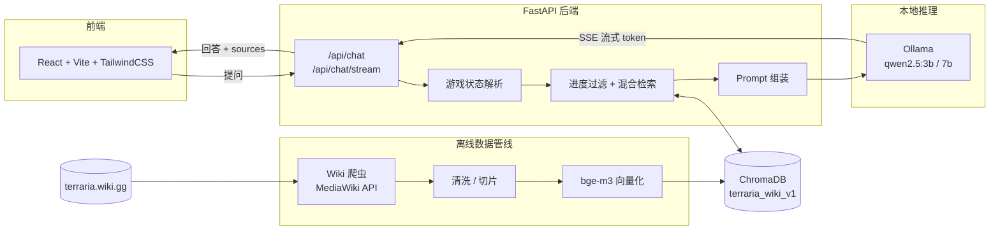

<div align="center">

<h1>TerraGuide · 泰拉向导</h1>

<p><strong>用自然语言问攻略，让每一条建议都有 Wiki 出处。</strong></p>

<p>面向《泰拉瑞亚》1.4 原版（Journey's End）的 AI 攻略问答助手</p>

[](#status)
[](https://www.python.org/)
[](https://fastapi.tiangolo.com/)
[](https://react.dev/)
[](https://www.trychroma.com/)
[](https://ollama.com/)
[](https://docs.docker.com/compose/)
[](#scope)
[](LICENSE)

</div>

---

<a id="about"></a>

## 关于 TerraGuide · About

**TerraGuide（泰拉向导）是一个面向《泰拉瑞亚》原版（vanilla）的 AI 攻略问答助手。**

传统攻略工具只能“查表”：你得先知道要查哪个 Boss、哪件装备，再去 Wiki 翻长长的表格。TerraGuide 让你直接用自己的话提问——比如“刚打完肉山，召唤师接下来该做什么装备”——并给出带来源引用的回答。

它不只做“检索 + 总结”。在回答之前，TerraGuide 会先解析你的**游戏进度、职业、难度和预算偏好**，再把检索范围收窄到当前进度真正可用的内容，避免把肉后装备推荐给肉前玩家。

- **技术栈**：FastAPI + ChromaDB + Ollama + React + Docker Compose（RAG 编排为轻量自研实现，LangChain 可选）
- **数据源**：Terraria 官方 Wiki（[terraria.wiki.gg](https://terraria.wiki.gg/)，通过 MediaWiki API 采集）
- **MVP 范围**：仅原版 1.4，不含 Mod / TModLoader 内容

### 它能回答什么样的问题

> “我刚打完肉山，玩召唤师，接下来优先做什么装备？”
>
> “专家模式机械骷髅王怎么打？我是战士，有钛金套。”
>
> “新三王之前，法师最好的武器是什么？”

这些问题的共同点是：答案取决于**你现在打到哪、玩什么职业、什么难度、愿意刷多久**。TerraGuide 的目标就是把 Wiki 里分散的词条，组合成针对你当前存档的建议。

<a id="status"></a>

## 🚧 项目状态

> [!NOTE]
> TerraGuide 目前处于早期开发阶段。仓库当前以项目计划、架构设计和目录骨架为主，核心功能仍在实现中。
>
> 下文描述的是项目的**目标形态**，快速开始中的命令、接口和目录结构会随开发进度调整。欢迎通过 Issue 关注进展或参与共建。

<a id="features"></a>

## ✨ 核心能力

| 能力 | 说明 |
|------|------|
| 💬 **自然语言问答** | 不需要记词条名，直接描述你的处境和需求 |
| 🧭 **游戏状态感知** | 从提问中解析进度、职业、难度、预算偏好，规则引擎覆盖大部分常见问法 |
| 🚧 **进度感知检索** | 用“当前阶段允许的内容集合”过滤候选片段，而不是简单排除后期物品 |
| 🔍 **混合检索** | 向量语义召回 + 专有名词精确匹配（武器 / Boss / 物品中英文别名） |
| 📎 **来源可追溯** | 回答附带 Wiki 页面标题与链接，方便核对原文 |
| ⚡ **流式输出** | SSE 逐 token 推送，首 token 等待时间更短 |
| 🧠 **多轮对话** | 保留最近 3 轮上下文，追问“那饰品呢”也能接得上 |
| 💻 **纯 CPU 可跑** | 默认 `qwen2.5:3b`，消费级 CPU 上约 8 tok/s；有 GPU 可切 7B |
| 🐳 **一键部署** | Docker Compose 编排前端、后端与 Ollama |
| 🌗 **轻量前端** | React + Vite + TailwindCSS，支持流式渲染、暗色主题与移动端布局 |

<a id="architecture"></a>

## 🏗️ 系统架构



### 离线：构建知识库

1. **采集**：通过 MediaWiki API 按分类白名单抓取原版页面，输出 Markdown 与结构化元数据。
2. **清洗**：提取正文、Infobox、合成配方；移除导航框、广告与 Mod 相关内容。
3. **切片**：按二级标题切分，每块约 500–800 tokens，相邻块重叠 100 tokens。
4. **向量化**：用 `bge-m3` 一次性生成索引向量，写入 ChromaDB collection `terraria_wiki_v1`。

### 在线：回答一个问题

1. **解析状态**：从自然语言中提取游戏进度、职业、难度与预算偏好。
2. **确定范围**：查“进度 → 允许集合”映射表，生成 ChromaDB 的 `where` 过滤条件。
3. **混合检索**：向量召回 Top 50，叠加专有名词精确匹配加权，合并后取 Top 10。
4. **生成回答**：把检索片段与游戏状态注入 System Prompt，调用 Ollama 生成分点建议。
5. **标注来源**：回答末尾附上参考的 Wiki 页面，前端渲染为来源卡片。

<a id="stack"></a>

## 🧰 技术栈

| 层级 | 选型 | 说明 |
|------|------|------|
| 前端 | React 18 + Vite + TailwindCSS | 轻量、组件生态成熟，适合对话式界面 |
| 后端 | Python 3.11+ / FastAPI / Uvicorn | 异步高性能，与 AI 生态衔接自然 |
| RAG 编排 | 原生 Python（LangChain 可选） | 检索 → 拼 Prompt → 调 Ollama，约 50 行；不依赖易变的 Chain / Memory 抽象 |
| LLM 运行时 | Ollama | 本地部署，直接调用 `/api/chat` |
| 默认模型 | `qwen2.5:3b` | CPU 友好；有 GPU 可通过环境变量切换 `qwen2.5:7b` |
| 向量库 | ChromaDB | 嵌入式，无需独立服务，支持元数据过滤 |
| Embedding | `bge-m3`（索引）+ `all-MiniLM-L6-v2`（查询） | 索引阶段一次性编码；查询用 45MB 轻量模型，后端不常驻大模型 |
| 爬虫 | requests + MediaWiki API + BeautifulSoup | Wiki 服务端渲染，无需浏览器；Playwright 仅作兜底 |
| 部署 | Docker Compose + Nginx + Certbot | 一键启动，Nginx 反代并处理 SSE，Let's Encrypt 提供 HTTPS |

<a id="scope"></a>

## 🎯 范围

**支持**：《泰拉瑞亚》1.4 Journey's End 原版内容，四个职业（战士 / 游侠 / 法师 / 召唤师），普通 / 专家 / 大师难度。

**不支持**：TModLoader、Calamity、Thorium 等 Mod 内容，以及 Mod 专属 NPC、物品与 Boss。

<details>
<summary><strong>纳入采集的 Wiki 分类（预估 2,000+ 页）</strong></summary>

| 分类 | 预估页面数 | 说明 |
|------|-----------:|------|
| Bosses | ~50 | 所有原版 Boss（含事件 Boss） |
| Weapons | ~400 | 四职业全武器 |
| Armor | ~100 | 全护甲套装 |
| Accessories | ~200 | 全饰品 |
| Items | ~1,500 | 消耗品、材料、方块等 |
| NPCs | ~30 | 原版 NPC 及其商店 |
| Game mechanics | ~80 | 战斗、挖矿、建造、农场等机制 |
| Events | ~20 | 血月、日食、南瓜月、霜月等 |
| Progression guides | ~30 | 各类进度指南 |

</details>

<a id="progression"></a>

## 🧭 进度模型：为什么用“允许集合”

一个常见的直觉是“排除肉后物品”。但当玩家说“刚打完肉山”时，他需要的恰恰是**肉后初级**装备，而不是把所有肉后内容都排除掉。

TerraGuide 的做法是维护一张**进度 → 允许的 Wiki 分类 / 元数据标签**映射表，检索时直接用 ChromaDB 的 `where` 条件过滤：

| 进度阶段 | 检索范围 |
|----------|----------|
| `pre_hardmode` | 仅肉前内容（`is_hardmode=false`），排除机械三王及之后 |
| `post_wall_of_flesh` | 硬模式早期，排除机械三王之后的内容 |
| `post_mech_bosses` | 排除世纪之花之后的内容 |
| `post_plantera` | 排除石巨人之后的内容 |
| `post_golem` | 排除邪教徒与四柱 |
| `post_cultist` | 包含四柱，排除月之领主掉落 |
| `post_moon_lord` | 全量内容 |

规则引擎就是一张 Python 字典，易读、易测、易扩展；比起散落各处的 `if/else`，也更容易解释“为什么推荐这件装备”。

<a id="quick-start"></a>

## 🚀 快速开始

> [!WARNING]
> 以下为目标形态的启动方式，相关代码仍在开发中，当前克隆仓库后尚不能直接运行。

### Docker Compose（推荐）

```bash
git clone <repository-url>
cd TerraGuide

# 启动前端、后端与 Ollama
docker compose up -d --build

# 首次启动需拉取模型（CPU 默认 3B；有 GPU 可换 7B）
docker compose exec ollama ollama pull qwen2.5:3b
```

启动后访问 `http://localhost`。

### 本地开发

```bash
# 后端
cd backend
python -m venv .venv
source .venv/bin/activate        # Windows: .venv\Scripts\activate
pip install -r requirements.txt
uvicorn app.main:app --reload --port 8000

# 前端（另开终端）
cd frontend
npm install
npm run dev
```

### 试抓 Wiki 原始 HTML

在仓库根目录运行：

```bash
python -m pip install -r crawler/requirements.txt
python -X utf8 crawler/scrape.py --limit 5
# 单独验证 Boss 分类翻页（每批最多 20 条）
python -X utf8 crawler/scrape.py --category bosses --limit 21
```

爬虫从 [`crawler/categories.yaml`](crawler/categories.yaml) 读取分类和标题排除词。`--limit` 限制每个分类的候选页面数，不是新保存的文件数；已存在或命中排除词的页面会跳过。原始 HTML 和抓取记录保存在 `crawler/raw/`，清洗和索引构建还未实现。

<a id="api"></a>

## 🔌 API 设计

| 方法 | 路径 | 功能 | 状态 |
|------|------|------|------|
| `POST` | `/api/chat` | 完整对话（非流式），返回 `{answer, sources}` | 规划中 |
| `POST` | `/api/chat/stream` | SSE 流式输出 token，结束时推送 `sources` | 规划中 |
| `GET` | `/api/health` | 后端、Ollama、ChromaDB 健康检查 | 规划中 |
| `GET` | `/api/sources` | 返回索引统计（页面数、分类分布、数据大小） | 规划中 |

<a id="structure"></a>

## 📁 目录结构

```text
TerraGuide/
├── frontend/                     # React 前端
│   ├── src/
│   │   ├── components/           # ChatBox / Message / SourceCard / GameContext / Sidebar
│   │   ├── api/                  # 后端 API 封装
│   │   ├── hooks/                # 自定义 hooks
│   │   ├── App.jsx
│   │   └── main.jsx
│   ├── vite.config.js
│   └── tailwind.config.js
│
├── backend/                      # FastAPI 后端
│   ├── app/
│   │   ├── main.py               # 应用入口
│   │   ├── api/                  # chat.py / health.py
│   │   ├── core/                 # rag.py / prompts.py / game_state.py / progression.py
│   │   ├── services/             # llm.py / vectorstore.py
│   │   └── config.py
│   ├── data/                     # ChromaDB 持久化目录
│   ├── requirements.txt
│   └── Dockerfile
│
├── crawler/                      # Wiki 离线采集
│   ├── scrape.py                 # MediaWiki API 抓取
│   ├── parser.py                 # HTML → Markdown + 元数据
│   ├── chunker.py                # 文档切片
│   ├── embed.py                  # bge-m3 批量向量化
│   ├── ingest.py                 # 写入 ChromaDB
│   ├── categories.yaml           # 原版分类白名单
│   └── raw/                      # 原始 Markdown 数据
│
├── eval/                         # RAG 评估
│   ├── baseline.py               # 无 RAG 基线
│   ├── test_cases.json           # 15 条测试问题 + 期望要点
│   └── compare.py                # 有 RAG vs 无 RAG 对比
│
├── docker-compose.yml
└── README.md
```

<a id="evaluation"></a>

## 📊 评测方案

TerraGuide 用数据回答“RAG 到底有没有用”，而不是只凭感觉。评测分为检索层与端到端两层：

| 指标 | 方法 | 目标 |
|------|------|------|
| 纯向量检索基线 | 10 条查询，统计 Top-10 是否包含正确页面 | 记录数字，不设硬指标 |
| 混合检索命中率 | 20 条查询，统计 Top-5 是否包含正确页面 | **≥ 80%** |
| RAG 端到端覆盖 | 15 条测试问题，人工核对核心要点覆盖率 | **≥ 70%** |
| 有 RAG vs 无 RAG | A 组仅 LLM，B 组完整 RAG，对比要点覆盖、名称准确性、进度匹配与引用 | B 组显著优于 A 组 |

除了准确率，还会记录以下性能目标：

| 场景 | 首 token | 端到端响应 |
|------|---------:|-----------:|
| 纯 CPU（3B） | ≤ 10 s | ≤ 20 s |
| GPU（3B） | — | ≤ 5 s |
| 并发 | — | ≥ 5 路对话 |

<a id="decisions"></a>

## ⚖️ 关键设计取舍

| 问题 | 选择与原因 |
|------|-----------|
| 为什么默认 3B 而不是 7B？ | 7B 在 CPU 上 prefill 要 20–30 秒，直接破坏体验；3B 约 8 tok/s，且 RAG 片段已提供强约束，退化可控。7B 作为 GPU 可选方案。 |
| 爬虫为什么不用 Playwright？ | Wiki 的 MediaWiki API 直接返回完整 HTML，无需浏览器。requests 的资源消耗约为 Playwright 的 1/100，2,000 页从数小时降到十几分钟。Playwright 仅处理极少数 API 内容不完整的页面。 |
| 为什么用“允许集合”而不是“排除规则”？ | 排除法会把“刚打完肉山”需要的肉后初级装备一起排掉。白名单映射表更符合玩家真实进度，也更好维护。 |
| 为什么 Embedding 不常驻后端？ | `bge-m3` 约 2GB，和 Ollama、FastAPI、ChromaDB 同跑在 8GB 机器上容易 OOM。索引阶段一次性算完，查询改用 45MB 的 `all-MiniLM-L6-v2`。 |
| 为什么坚持混合检索？ | 向量擅长“召唤师肉后起步 ≈ summoner early hardmode”这类语义；但 `Zenith`、`Terra Blade`、`Plantera` 等专有名词必须精确命中，关键词一路不能省。 |
| 为什么不用 LangChain 的 Memory / Chain？ | 0.3.x 之后 Memory 模块迁移，照着旧教程写容易踩 import 错误。多轮对话直接保留最近 3 轮原生 messages，编排自己写 50 行，更可控。LangChain 保留为可选封装。 |

<a id="roadmap"></a>

## 🗺️ Roadmap

- [x] **Phase 0**：需求梳理、技术选型与架构设计
- [ ] **Phase 1**：Wiki 数据采集与 RAG 底座
  - [ ] MediaWiki API 爬虫与分类白名单
  - [ ] 正文 / Infobox / 合成配方清洗
  - [ ] 切片、`bge-m3` 向量化与 ChromaDB 入库
  - [ ] 纯向量基线评测 + 混合检索（Top-5 命中率 ≥ 80%）
- [ ] **Phase 2**：FastAPI RAG 引擎
  - [ ] `/api/chat`、`/api/chat/stream`、`/api/health`、`/api/sources`
  - [ ] 游戏状态解析与进度映射表
  - [ ] Prompt 模板与 Ollama 客户端
- [ ] **Phase 2.5**：RAG 基线对比（15 条问题，有 / 无 RAG）
- [ ] **Phase 3**：React 前端
  - [ ] 对话、来源卡片、游戏状态面板、历史会话
  - [ ] SSE 打字机效果、快捷提问、暗色主题、移动端适配
- [ ] **Phase 4**：Docker Compose 部署、HTTPS 与公网验证

<a id="contributing"></a>

## 🤝 贡献

项目仍在早期，欢迎任何形式的参与：

- 发现设计问题或有想问的典型问题，欢迎开 **Issue** 讨论；
- 想提交代码，建议先开 Issue 对齐范围，避免和进行中的工作冲突；
- 如果愿意贡献 Wiki 测试问题，请在 `eval/test_cases.json` 中补充“问题 + 期望要点 + 参考页面”。

<a id="acknowledgements"></a>

## 🙏 致谢与声明

- 感谢 [terraria.wiki.gg](https://terraria.wiki.gg/) 社区维护的 Wiki，以及 [MediaWiki](https://www.mediawiki.org/) 提供的开放 API。
- 感谢 [Ollama](https://ollama.com/)、[ChromaDB](https://www.trychroma.com/)、[FastAPI](https://fastapi.tiangolo.com/)、[React](https://react.dev/) 等开源项目。
- 《泰拉瑞亚》（Terraria）及相关素材版权归 **Re-Logic** 所有。本项目是非官方粉丝项目，与 Re-Logic 无关联。
- Wiki 内容的使用请遵循 terraria.wiki.gg 的许可协议，并保留原始出处。

<a id="license"></a>

## 📄 License

本项目采用 [MIT License](LICENSE) 开源。

```text
Copyright (c) 2026 TerraGuide contributors
```

MIT 许可仅覆盖本仓库的代码。Wiki 内容、Terraria 游戏素材及相关商标仍归其各自权利人所有，使用时应遵循对应许可与声明。
