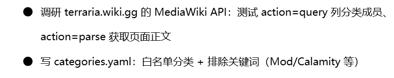
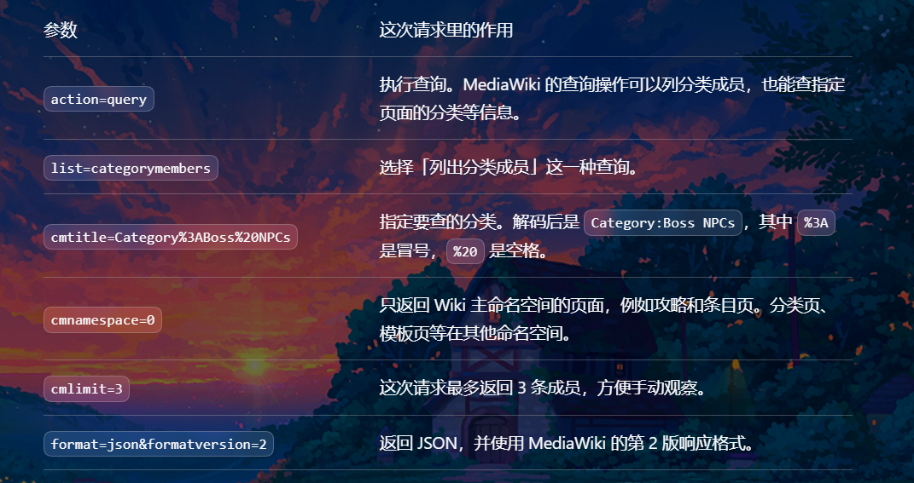

# 				*Terraguide**随手记*（*11.23*）

对于Terraguide中

任务所遇到问题：
1.疑问：对于action=query的意义的疑问，以及相似用法的不了解；

  解答：action是指需要执行的一个操作，然后query则是查询；相似用法：

2.疑问：拿到了continue之后怎么拿到下一批数据
  解决：保留原查询参数，把响应里 `continue` 对象中的 `continue` 和 `cmcontinue` 两个值一起传回去。
3.疑问：按照计划的分类名进行查询却返回了空列表如[第一次查询链接](https://terraria.wiki.gg/api.php?action=query&prop=categories&titles=Eye%20of%20Cthulhu&cllimit=max&format=json&formatversion=2)
  解决：使用已知的信息来确认WIKI里面的实际使用名称，[第二次查询](https://terraria.wiki.gg/api.php?action=query&prop=categories&titles=Eye%20of%20Cthulhu&cllimit=max&format=json&formatversion=2)然后通过第二次查询拿到的`{"ns": 14, "title": "Category:Boss NPCs"}`；来进行第三次查询只修改分类名，保持其他的参数再次进行查询：[第三次查询](https://terraria.wiki.gg/api.php?action=query&list=categorymembers&cmtitle=Category%3ABoss%20NPCs&cmnamespace=0&cmlimit=3&format=json&formatversion=2)

总结：对于计划中的Boss知识自己的叫法，然而传给cmtitle的时候则是需要使用WIKI里面实际用名，如果无法查询则使用已知来进行反查，同样，其他的也可以这么进行复测